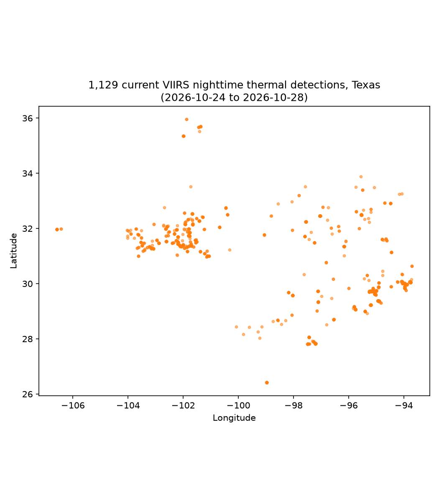
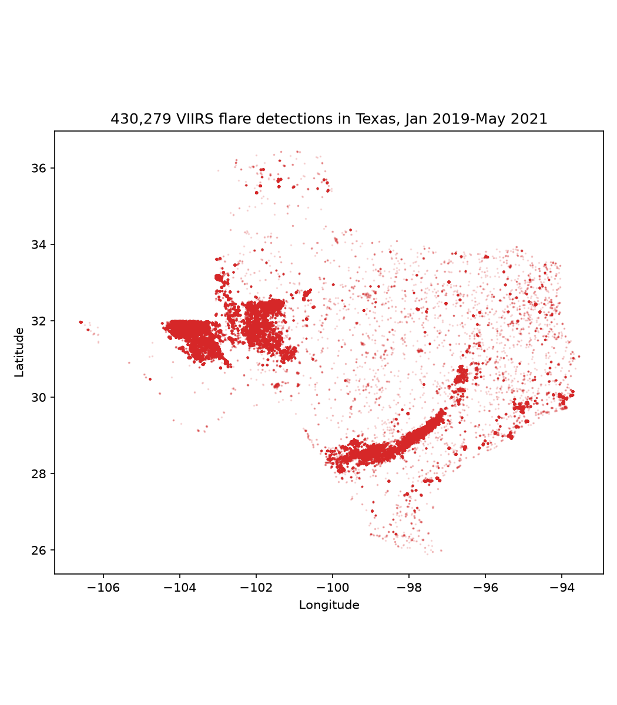
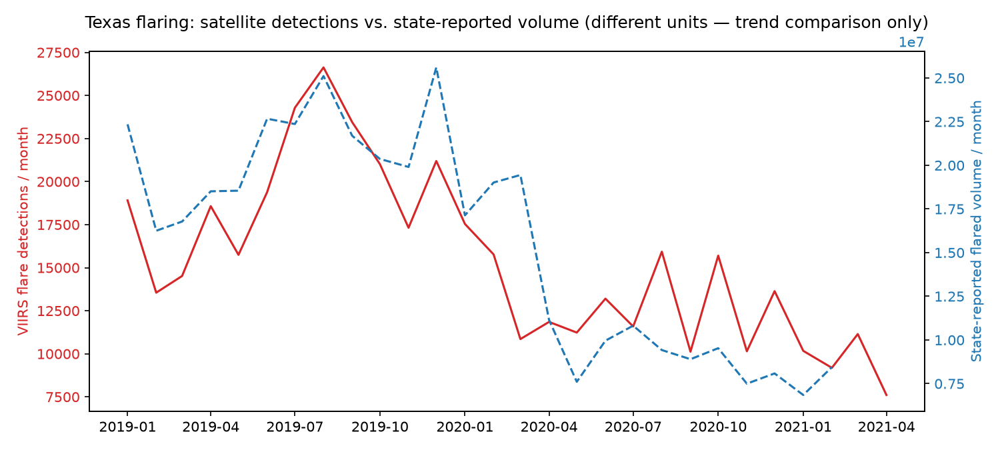

# Flare Watch

Where Texas oil & gas flaring happens, who's nearest to it, and how it's
trended — built on public satellite data.

Status: **v1 — actually current now, via a different NASA system than
the one that was a dead end.** Part of
[Bat City AI](https://batcityai.com)'s Year One programs.

## Quickstart (current data)

```bash
python3 -m venv .venv && source .venv/bin/activate
pip install -r requirements.txt

# Free, instant, no institutional review (unlike EOG — see below):
# https://firms.modaps.eosdis.nasa.gov/api/map_key/
echo "FIRMS_MAP_KEY=your_key_here" > .env

python3 scripts/fetch_firms.py    # ~10s: last 5 days, 3 VIIRS satellites
python3 scripts/current_flares.py # ~10s: map + operator leaderboard
```

Produces a map and a "top operators" leaderboard from the **last 5
days** of real satellite detections — genuinely current, not the 2019-2021
historical data described further down.

Both maps (this one and the historical one below) render on a real
basemap — state lines, rivers, cities, terrain — via `scripts/mapping.py`.
Worth knowing: two of the three "free" tile providers tried first didn't
actually work unauthenticated (CartoDB now requires an API key;
OpenStreetMap's own tiles reject library/script access per their usage
policy, not a bug). Esri's World Topo tiles are the ones that are
genuinely open for this.



## Why NASA FIRMS instead of EOG's VIIRS Nightfire

We originally tried to get current data from EOG (Colorado School of
Mines), the official source for the historical data below. That turned
out to be a real dead end for a project like this one — see
[Known Limitations](#known-limitations). **FIRMS is a different system**:
NASA's own active-fire/thermal-anomaly detection algorithm, run on the
same VIIRS satellites, with instant free access (just an email) instead
of EOG's academic/commercial/non-profit license tiers.

**The honest tradeoff**: FIRMS is built to detect wildfires, not flares
specifically — it flags any persistent heat source. In the Permian Basin
and Eagle Ford (sparse desert/scrubland, dense with known well clusters,
little wildfire risk), a detection recurring at the same point night
after night is almost certainly a flare. This script doesn't prove that;
it's the same kind of reasonable-first-pass logic as the nearest-well
attribution below, not a certainty.

**A second, more interesting finding**: fixing the *detection* data
exposed that the *well location* data (`tx_wells.csv`, used for operator
attribution) is still the 2021 snapshot. Match rate against a known well
within 2km dropped from 92% (historical) to **53% (current)** — wells
drilled after 2021 that are now flaring simply aren't in the well
dataset yet. Current detections, stale attribution: a real example of
fixing one bottleneck and immediately finding the next one.

## Historical analysis (2019-2021)

```bash
python3 scripts/fetch_data.py   # ~1 min: downloads + Texas-filters the data
python3 scripts/analyze.py      # ~30s: map, trend, operator leaderboard
```

Produces:
- **A map** of every satellite-detected flare in Texas — the Permian
  Basin and Eagle Ford light up exactly where you'd expect.
- **A monthly trend** of detections vs. state-reported flaring volume.
  The 2020 oil crash is visible in both series.
- **A "top operators" leaderboard** — each detection matched to its
  nearest Texas well (within 2km) via a spatial join, then counted up by
  operator. 92% of detections matched within 2km here, vs. 53% for the
  current FIRMS data above — see why in the section above.





**This data runs from January 2019 to May 2021 only.** Here's why:
"Flaring Monitor," the project behind this GitHub mirror, was a one-time
open-data release in [May 2021](https://www.axios.com/2021/05/11/natural-gas-flaring-monitor)
by [Bazean](https://www.crunchbase.com/organization/bazean), a Houston
oil & gas analytics company, accompanying a white paper on satellite-
based flare-volume estimation — not a funded ongoing monitor, more a
one-time demo tied to a product/PR launch. The last commit to the
underlying repo was June 28, 2021; `flaringmonitor.org` itself is dead
now. Within that window the data checks out against reality: both
satellite detections and state-reported volumes crater in exactly the
months Texas drilling activity actually crashed (the COVID demand shock
+ 2020 oil price war).

## Why a real polygon, not a bounding box

Texas and New Mexico share a border that runs straight through the
Permian Basin — exactly where most of this flaring happens. A naive
lat/lon bounding box around Texas would scoop up New Mexico detections.
Both `fetch_data.py` and `fetch_firms.py` use Texas's actual boundary
polygon for an exact point-in-polygon filter instead: of ~501,000
historical detections in the Texas bounding box, **71,000 (14%) were
actually across the border in New Mexico** and get correctly excluded.

## The operator leaderboard isn't a legal claim

"Nearest well within 2km" is a reasonable first-pass attribution, not
proof a specific well caused a specific flare. Flares can be offset from
the wellhead, wells cluster tightly together, and satellite geolocation
has its own error.

## Prior art

[FlareIntel](https://flareintel.com) (by Capterio) is a global, more
polished flare tracker built on the official EOG Nightfire data, with
operator and field attribution already built in — worth knowing about
before assuming this space is empty. As far as public documentation
shows, FlareIntel Free gives annualized aggregates through an
interactive map, with daily/near-real-time data reserved for the paid
Pro tier, and no confirmed bulk CSV export or API for either. This
project is narrower (Texas only) but open end to end: every raw input
file, the exact spatial-join logic, and the full attributed-detection
output are all re-runnable and inspectable, not a hosted black box.

## Data sources

- **Current detections**: [NASA FIRMS](https://firms.modaps.eosdis.nasa.gov/)
  — VIIRS thermal-anomaly detections (Suomi NPP, NOAA-20, NOAA-21),
  NASA's own active-fire algorithm, free instant API key.
- **Historical detections (2019-2021)**: VIIRS is the imaging instrument
  on NASA/NOAA satellites; **Nightfire** is the flare-specific detection
  algorithm — developed by the Earth Observation Group (EOG) at the
  Colorado School of Mines, not NASA/NOAA (Elvidge et al., 2013) — via
  [flaringmonitor/viirs-flare-data](https://github.com/flaringmonitor/viirs-flare-data),
  a public mirror of EOG's output.
- **Well locations, operators, and state-reported flaring volumes**:
  same historical mirror, sourced from Texas Railroad Commission
  records. Not current (see above) — this is the actual bottleneck on
  the current pipeline's operator attribution, not the detections.

## Known limitations

- **Current operator attribution is bottlenecked by stale well data**
  (53% match rate vs. 92% historical) — getting a current TX well list
  (the Railroad Commission publishes one) would fix this directly, and
  is the highest-value next step.
- **FIRMS isn't flare-specific.** It's a wildfire-detection system that
  happens to catch flares as a side effect. No validation yet that
  Texas detections aren't occasionally real fires, agricultural burns,
  or other industrial heat sources.
- **EOG's official VIIRS Nightfire access is a genuine dead end for this
  project, not just unfinished.** Checked properly: free registration is
  only step one. VNF data itself requires a separate signed license with
  exactly three categories — Academic (free, but requires institutional
  affiliation), Commercial (paid, cost undisclosed), and Non-Profit
  (paid annual subscription, "for qualified organizations"). None fit an
  independent individual project. Effective June 2026, even a free
  account's programmatic access is paid-subscriber-only regardless of
  license category.
- **Climate TRACE** (free, live via API, verified working —
  `api.climatetrace.org/v7/sources`) could supplement the trend chart —
  it reports modeled CO2e emissions per oil/gas play, not per-flare
  detections, so it's a trend indicator, not a map/leaderboard source.
- **2km match radius wasn't tuned.** Chosen as a reasonable-sounding
  default, not validated against ground truth.
- **Detection counts, not flare volumes.** The operator leaderboards
  count satellite detections, which isn't the same as total gas flared.
  `frp`/`rh` (radiant heat / fire radiative power) are in both datasets
  and unused — summing them per operator would be more physically
  meaningful than a raw count.
- **No temporal pattern analysis.** Do specific operators flare more at
  night, on weekends, or right before reporting deadlines? The data
  could answer this; it hasn't been asked yet.

## License

MIT
